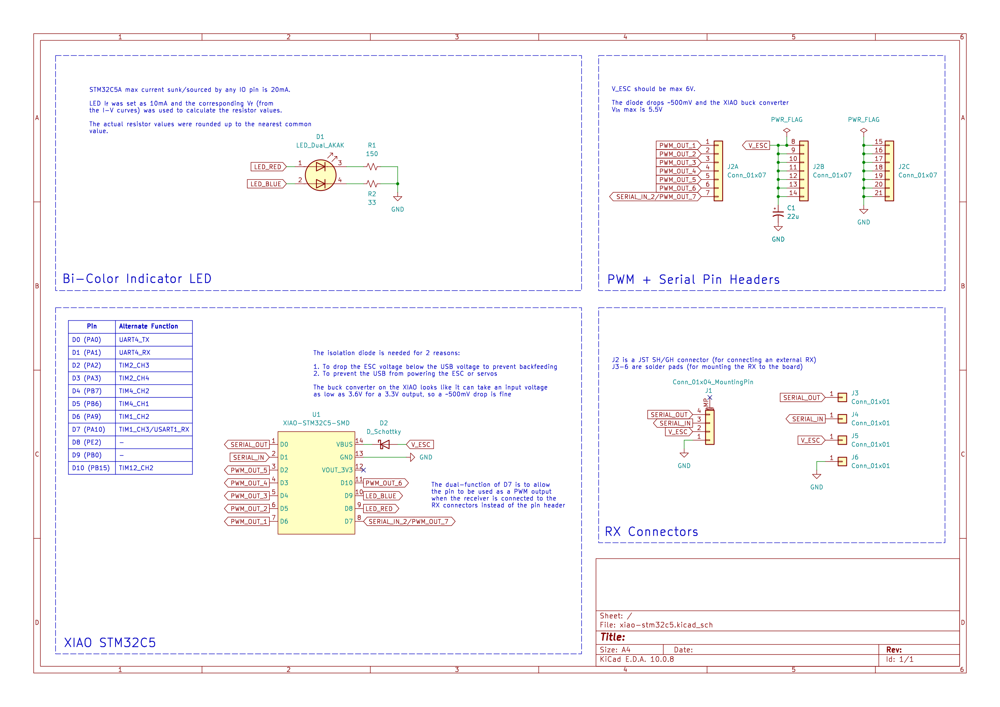
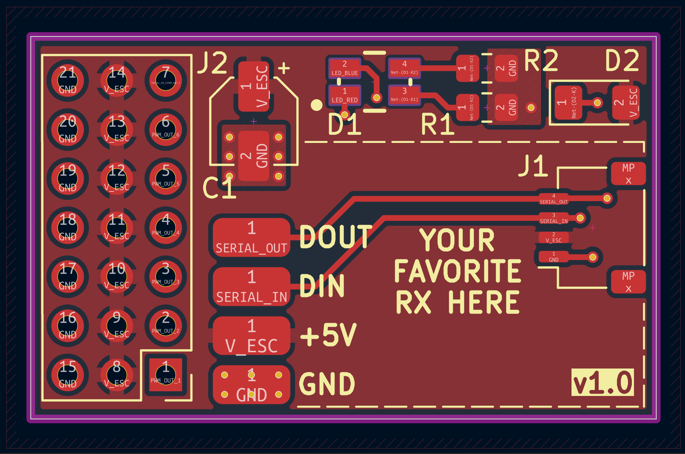
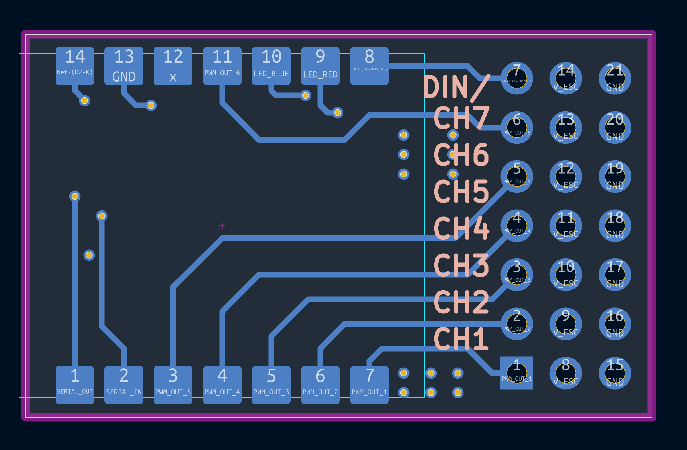
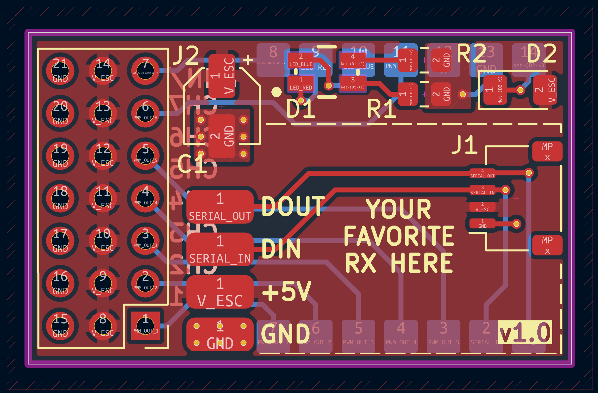
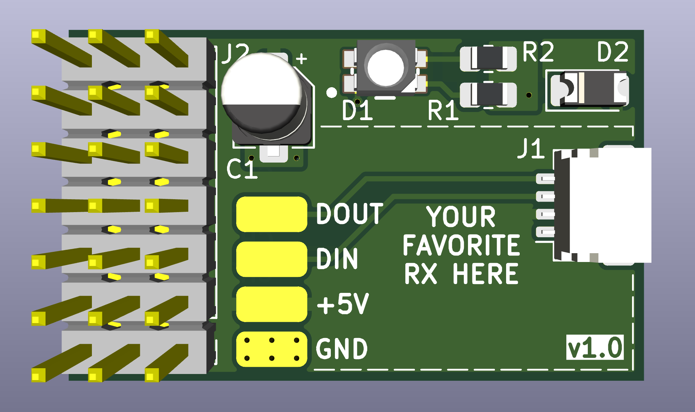
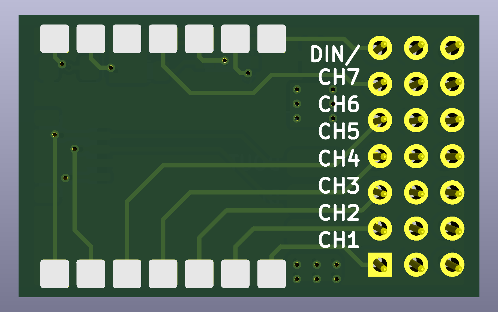

# Description
Carrier board for a `SeeedStudio XIAO STM32C5` that allows it to be used as a 7-channel gyro for RC planes

# Features
- Only 7 total components (excluding the `XIAO STM32C5`)
  - 3 are truly needed (22uF servo bulk capacitor, XIAO Vin diode, servo pin header)
  - JST connector is optional and only needed if you intend on connecting a receiver to it
- Bi-color indicator LED (blue, red)
- Hand-solder-friendly components/footprints
- 3 possible serial receiver connections
  1. Receiver serial output connected to pin header DIN/CH7
  2. Receiver UART soldered to solder pads
  3. Receiver UART connected to JST connector
- Channel 7 is dual-purpose (can either be a serial receiver input, or a channel output)
  - It's also a separate UART so it can be used as a PWM output if the receiver is connected to the solder pads or the JST connector

# Layer Stackup
This is a 4-layer board with the following stackup:

1. Signal + Power
2. Ground
3. Ground
4. Signal

Both ground layers are solid ground pours and aren't shown in the images section below

# BOM
Reference|Qty|Value|MPN
---|---|---|---
C1|1|22u|EEE-FK1H220P
D1|1|LED_Dual_AKAK|150141RB73100
D2|1|D_Schottky|SD1206S040S1R0
J1|1|Conn_01x04_MountingPin|SM04B-SRSS-TB
J2|1|Conn_03x07|TSW-107-26-F-T
R1|1|150|RC0805FR-07150RL
R2|1|33|RC0805FR-0733RL
U1|1|XIAO-STM32C5-SMD|

> [!NOTE]
> J2 is a 3x7 2.54mm pitch pin header. This part can be replaced with three 7-pin headers or seven 3-pin headers or some other combination to save cost

# Usage
WIP

# Images
## Schematic

## PCB
### Top Layer

### Bottom Layer

### Top + Bottom Layer

## 3D View
### Top

### Bottom

